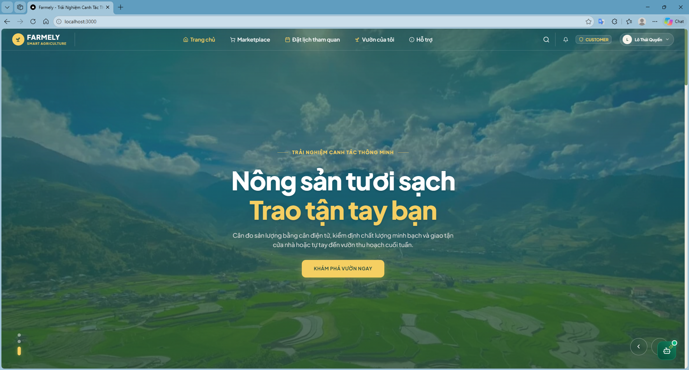
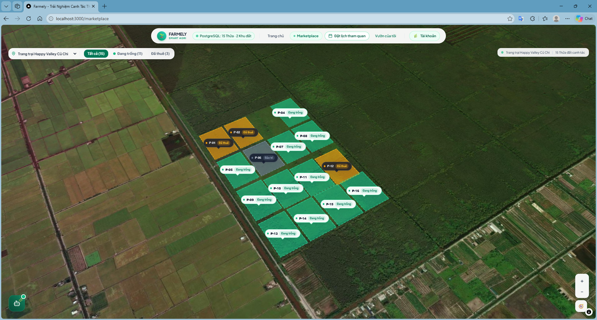
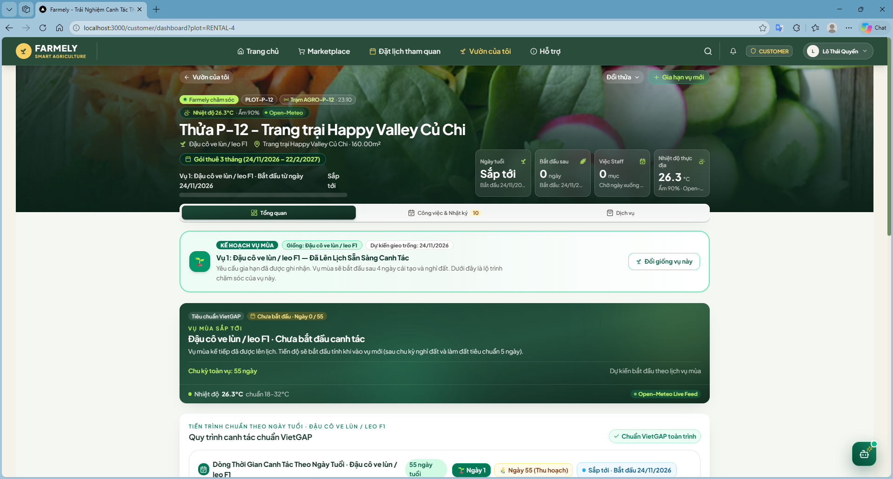
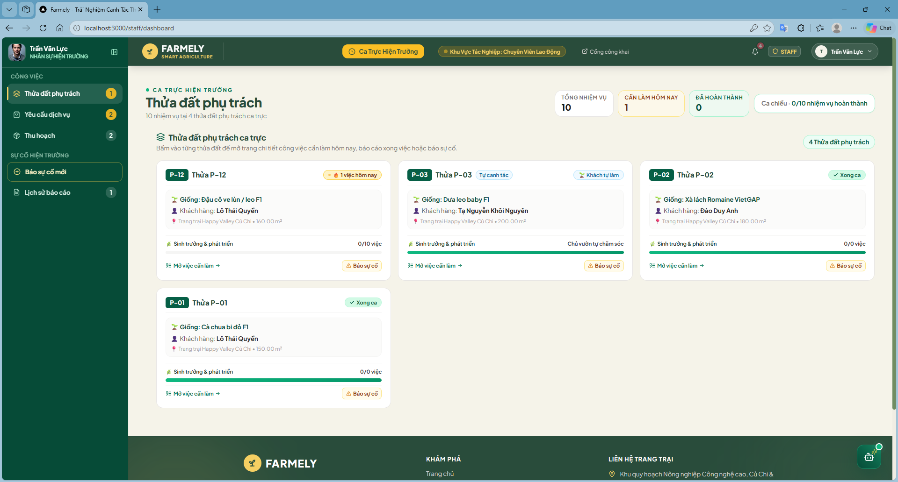
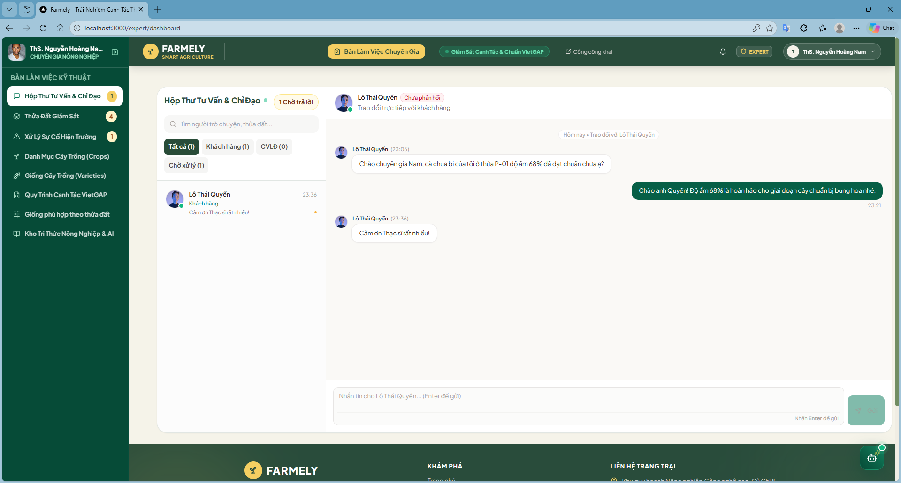
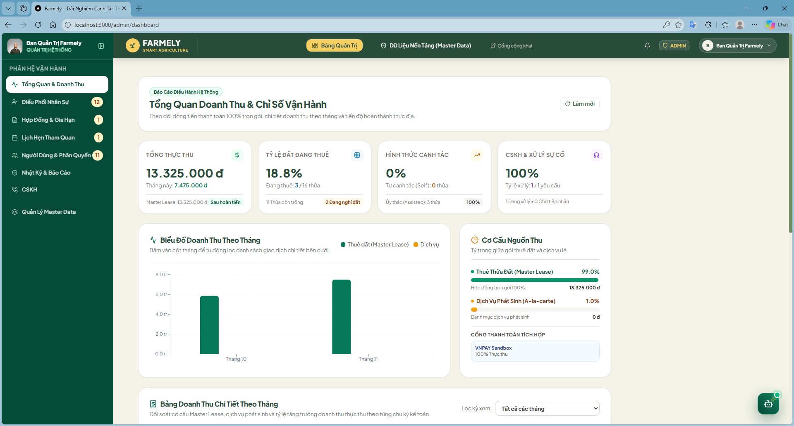
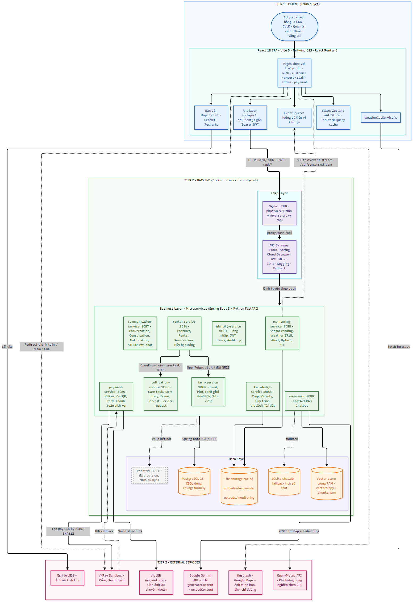
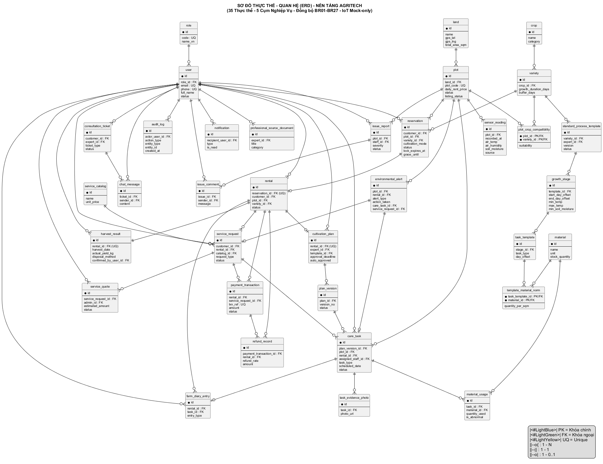

<div align="center">

# 🌾 Farmely
### Smart Farm Plot Rental & Transparent Cultivation Tracking Platform

[](./frontend)
[](./backend)
[-336791?style=flat-square&logo=postgresql&logoColor=white)](./docs/database/farmely_full_database.sql)
[](./backend/ai-service)
[](./frontend/src)
[](./docker-compose.yml)

<p align="center">
  A full-stack agritech platform where customers rent <strong>real farm plots</strong> on an interactive GIS satellite map, choose <strong>VietGAP-standardized crops</strong>, opt between <strong>Self-growing</strong> or <strong>Assisted-growing</strong> care plans, and track crop progress remotely through microclimate weather data, photo-verified field diaries, an AI agronomy assistant, and live expert consultation.
</p>

<p align="center">
  <a href="#-demo-video"><strong>🎬 Demo Video</strong></a> ·
  <a href="#-screenshots"><strong>📸 Screenshots</strong></a> ·
  <a href="#-system-architecture--tech-stack"><strong>🏗️ Architecture</strong></a> ·
  <a href="#-getting-started"><strong>🚀 Quick Start</strong></a> ·
  <a href="#-demo-accounts"><strong>🔑 Demo Accounts</strong></a>
</p>

<a id="-demo-video" href="https://youtu.be/Or5_FkHV9C0">
  
</a>
<br />
<sub>▶️ <strong>Click the banner above to watch the full Demo Video on YouTube</strong></sub>

</div>

---

## ✨ Key Features

- **🗺️ Interactive GIS Satellite Marketplace (`MapLibre GL + GeoJSON`):** Visualizes 16 real farm plots (`P-01` → `P-16`) with polygon boundaries, real-time availability status (`AVAIL`, `RENT`, `MAINT`), and plot-to-variety compatibility filtering.
- **📜 Master Lease Booking & VNPay Checkout:** Supports multi-plot master lease agreements, a 15-minute reservation hold with automatic timeout release, 100% lump-sum online payment (`VNPay Sandbox 2.1.0`), contract renewal, and tiered refund cancellation.
- **🌱 Dual Cultivation Modes & 10 VietGAP Templates:** Automatically generates scheduled field tasks (`Care Tasks`) from 10 standardized VietGAP crop processes (88 milestones) for `Assisted-growing`, or offers on-demand à-la-carte services (`S01`–`S15`) for `Self-growing`.
- **🌦️ Microclimate Monitoring & Photo-Verified Farm Diaries:** Tracks soil moisture, temperature, and weather alerts; enforces mandatory field-photo evidence for completed tasks and transparent harvest weighing (`PICKUP` / `DELIVERY`).
- **🤖 Farmely AI (Hybrid RAG) & Real-Time Expert Chat:** Combines a 24/7 Gemini-powered Hybrid RAG chatbot grounded in VietGAP/IPM manuals with real-time 1-on-1 messaging and cross-role system notifications.

### Role-Based Access Control (4 Roles)

| Role | Core Capabilities |
| :--- | :--- |
| **👤 Customer (`CUSTOMER`)** | Explore plots on the GIS map, book site visits, sign lease contracts, track diaries & weather, order extra care services, submit support tickets, confirm harvest delivery. |
| **🧑‍🔬 Agronomist (`EXPERT`)** | Manage crops & varieties, author VietGAP cultivation templates, configure plot-variety compatibility, diagnose field issues, dispatch urgent tasks, consult customers & staff. |
| **👷 Field Worker (`FIELD_WORKER`)** | Execute assigned care tasks & à-la-carte services, upload mandatory field-photo proof to diaries, host site visits, report field issues, record harvest yields. |
| **🛡️ Administrator (`ADMIN`)** | Manage users & RBAC role assignments, publish lands/plots, approve contracts/cancellations/renewals, coordinate staff, handle customer support tickets & audit logs. |

---

## 👨‍💻 My Role & Key Contributions

> *Academic Capstone Project (**ISP392** — FPT University) · Full-Stack Microservices Architecture*
<!-- Customize these bullet points to match your personal CV focus -->

- **Full-Stack Feature Delivery:** Built end-to-end workflows across React 19 and Spring Boot 3, including multi-step plot & land preparation (`Admin Draft → Expert Variety/Template → Publish → Marketplace`), booking lead-time validation, and contract renewal/cancellation flows.
- **RBAC & Support Notification System:** Implemented Admin role management (`ADMIN`, `EXPERT`, `FIELD_WORKER`, `CUSTOMER`) with self-demotion/last-admin guards and bidirectional real-time notifications between Customers and Admins for support tickets.
- **AI Chat & Realtime Communication:** Grounded the Gemini Hybrid RAG assistant with live plot/rental context and synchronized multi-tab customer–expert messaging (`PostgreSQL` + `BroadcastChannel`).
- **Testing & Performance:** Added automated unit tests with **Vitest** and **JUnit/MockMvc**, streamlined dashboard UI responsiveness, and tuned JVM memory flags for multi-service local/Docker runs.

---

## 📸 Screenshots

<div align="center">
  <table>
    <tr>
      <td width="50%" align="center">
        
        <br /><sub><strong>Landing Page</strong></sub>
      </td>
      <td width="50%" align="center">
        
        <br /><sub><strong>Marketplace (GIS Satellite Map)</strong></sub>
      </td>
    </tr>
    <tr>
      <td width="50%" align="center">
        
        <br /><sub><strong>Customer Dashboard</strong></sub>
      </td>
      <td width="50%" align="center">
        
        <br /><sub><strong>Staff Dashboard (Field Worker)</strong></sub>
      </td>
    </tr>
    <tr>
      <td width="50%" align="center">
        
        <br /><sub><strong>Expert Dashboard (Agronomist)</strong></sub>
      </td>
      <td width="50%" align="center">
        
        <br /><sub><strong>Admin Dashboard & RBAC</strong></sub>
      </td>
    </tr>
  </table>
</div>

---

## 🏗️ System Architecture & Tech Stack

- **Frontend:** React 19, Vite 6, Tailwind CSS 4, MapLibre GL (GeoJSON GIS), Zustand, Recharts, Vitest (`:3000`)
- **Backend:** Java 21, Spring Boot 3, Spring Cloud Gateway (`:8080`), Spring Data JPA (8 Domain Microservices `:8081`–`:8088`)
- **AI Service:** Python FastAPI Hybrid RAG (`:8089`) — Google Gemini LLM + Vector Embeddings over VietGAP/IPM knowledge base
- **Database & Infra:** PostgreSQL 16 (28 normalized 3NF tables, 17 enums, triggers), RabbitMQ 3.13, Docker Compose

<details>
<summary><strong>📐 Expand Service Ports, 3-Tier Architecture & ERD Diagrams</strong></summary>
<br />

| Service | Port | Responsibility |
| :--- | :---: | :--- |
| `frontend` | `3000` | React 19 SPA, MapLibre GIS UI & Vite dev API middleware |
| `api-gateway` | `8080` | Centralized REST routing, JWT validation & CORS |
| `identity-service` | `8081` | Authentication, user accounts & RBAC (`users`, `roles`, `audit_logs`) |
| `farm-service` | `8082` | Lands, GeoJSON plots & site visit scheduling (`lands`, `plots`, `site_visits`) |
| `knowledge-service` | `8083` | Crops, varieties, VietGAP templates & PDF docs (`process_templates`, `template_steps`) |
| `rental-service` | `8084` | Reservations, master leases, renewals & cancellations (`contracts`, `rentals`) |
| `payment-service` | `8085` | VNPay Sandbox 2.1.0 checkout & refunds (`payment_transactions`) |
| `cultivation-service` | `8086` | Care tasks, photo diaries, field issues & harvests (`care_tasks`, `farm_diaries`) |
| `communication-service` | `8087` | Live chat, notifications & support tickets (`conversations`, `messages`, `support_tickets`) |
| `monitoring-service` | `8088` | Microclimate readings & threshold alerts (`sensor_readings`, `iot_alerts`) |
| `ai-service` | `8089` | Farmely AI Hybrid RAG agronomy assistant |

<div align="center">
  
  <br /><br />
  
</div>

</details>

---

## 🚀 Getting Started

### Prerequisites
- **Docker & Docker Compose** *(recommended for full-stack startup)*, or:
- **Node.js `>= 18`**, **PostgreSQL `>= 14`**, and **JDK `17/21`** *(for local development)*

### 1. Environment Configuration
Copy the template file and fill in your local credentials (never commit `.env`):
```bash
cp .env.example .env
```
> Set `GEMINI_API_KEY` (Google AI Studio) and `VNP_TMN_CODE` / `VNP_HASH_SECRET` (VNPay Sandbox) in `.env` if you want live AI & payment sandbox integration.

### 2. Run the Application

**Option A — Docker Compose (Full Stack):**
```bash
docker compose up -d --build
```
The PostgreSQL container automatically initializes all 28 tables and seed data from [`docs/database/farmely_full_database.sql`](./docs/database/farmely_full_database.sql). Open **`http://localhost:3000`**.

**Option B — Local Development (Frontend + Local PostgreSQL):**
```bash
# 1. Seed PostgreSQL database (28 tables + VietGAP sample data)
psql -U postgres -d farmely -f docs/database/farmely_full_database.sql

# 2. Start Frontend & Dev API server (http://localhost:3000)
cd frontend
npm install
npm run dev
```

**Option C — Windows 1-Click Local Stack:**
```powershell
.\start-dev.ps1        # Start all microservices & frontend
.\status-dev.ps1       # Check running services
.\stop-dev.ps1         # Stop all services
```

### 3. Run Automated Tests
```bash
cd frontend && npm test
```

---

## 🔑 Demo Accounts

> Default password for all seeded accounts: **`Password@123`**

| Role | Email | Display Name | Scope |
| :--- | :--- | :--- | :--- |
| **🛡️ ADMIN** | `admin@farmely.vn` | Ban Quản Trị Farmely | Full platform & RBAC management |
| **🧑‍🔬 EXPERT** | `expert@farmely.vn` | ThS. Nguyễn Hoàng Nam | Lead agronomist & VietGAP templates |
| **👷 FIELD_WORKER** | `worker@farmely.vn` | Trần Văn Lực | Field tasks, photo logs & harvest |
| **👤 CUSTOMER** | `customer@farmely.vn` | Lô Thái Quyền | Active rental on plot `P-01` |

---

## 📂 Project Structure

```text
Farmely/
├── backend/                # 10 Microservices (Spring Boot 3 + FastAPI AI RAG)
├── frontend/               # React 19 + Vite + Tailwind + MapLibre GL + Vitest
├── docs/                   # SRS, Business Rules (BR01–BR27), ERD & SQL scripts
│   ├── academic/           # Single Source of Truth specification: RP39 (NEW).md
│   ├── database/           # Full PostgreSQL schema & seed (farmely_full_database.sql)
│   └── diagrams/           # Architecture, Context, Use Case & ERD diagrams
├── Start/                  # Windows 1-Click helper scripts
├── .env.example            # Environment variable template (no real secrets)
└── docker-compose.yml      # Full-stack Docker orchestration
```

---

<div align="center">
  <sub>Built for <strong>ISP392 — Information Systems Project</strong> · <strong>FPT University</strong> · © 2026 Farmely Team</sub>
</div>
