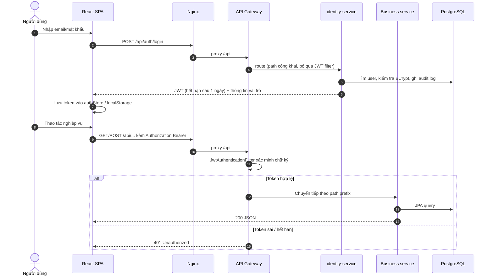
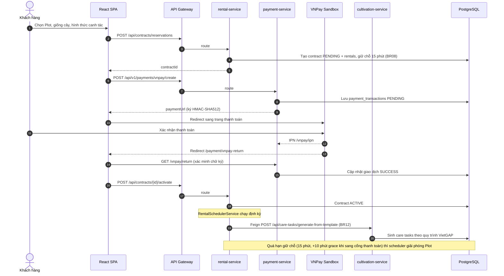
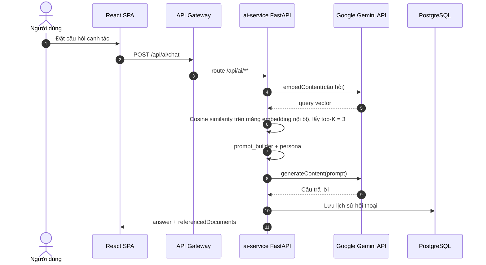
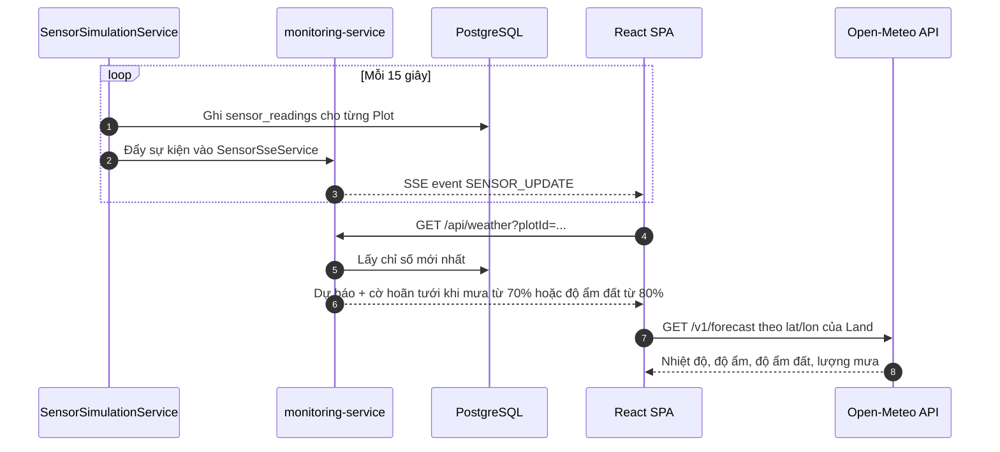

# Farmely — System Architecture (Microservice Architecture)

> Sơ đồ kiến trúc được chuẩn hóa theo chuẩn quốc tế (format Sparx IT Microservice Architecture) và phản ánh trung thực mã nguồn thực tế (`docker-compose.yml`, `api-gateway`, 9 microservices, database, message broker và các dịch vụ ngoại vi).
> 3 phân vùng chính: **Client Tier**, **Backend & Data Tier** (API Gateway, Microservices, PostgreSQL, RabbitMQ), **External APIs**.

---

## 1. Sơ đồ tổng thể (Format Microservice Architecture)

> **File sơ đồ chính thức:** [`system_architecture.drawio`](../diagrams/system_architecture.drawio) · **Ảnh render:** [`system_architecture.png`](../diagrams/system_architecture.png)  
> Bố cục ngang chuẩn:
> - **Client**: Cụm thiết bị đa nền tảng (Laptop/Desktop, Tablet, Smartphone) đại diện cho Single Page Application chạy trên trình duyệt web, gửi yêu cầu qua giao thức mạng `API Request` (`HTTPS / JSON + JWT`).
> - **API Gateway (:8080)**: Cổng vào duy nhất tiếp nhận request, xác thực JWT token, xử lý CORS, Rate Limiting và định tuyến (Routing) vào các service nội bộ.
> - **Centralized Management**: Hạ tầng Docker Compose, Bridge Network, quản lý Healthcheck và giám sát trạng thái dịch vụ.
> - **9 Microservices**: 8 Spring Boot services + 1 FastAPI AI Service, giao tiếp đồng bộ qua `OpenFeign` (Rental ↔ Farm, Rental ↔ Cultivation).
> - **Database Layer**: CSDL quan hệ trung tâm `PostgreSQL 16` (`farmely`) cùng `File Storage` lưu trữ tài liệu kỹ thuật & ảnh hiện trường.
> - **Message Broker (RabbitMQ :5672)**: Hàng đợi thông điệp phục vụ luồng sự kiện bất đồng bộ (*Asynchronous Messaging*).
> - **External APIs**: Tích hợp các bên thứ 3 gồm `Google Gemini API` (LLM & Embeddings), `VNPay / VietQR` (Thanh toán), `Esri ArcGIS` (Ảnh vệ tinh), và `Open-Meteo` (Dự báo thời tiết).

```mermaid
flowchart TB
    %% ====================== TIER 1 - CLIENT ======================
    subgraph T1["TIER 1 - CLIENT (Trình duyệt)"]
        direction TB
        USR(["Actors: Khách hàng · CGNN · CVLĐ · Quản trị viên · Khách vãng lai"])
        subgraph SPA["React 18 SPA - Vite 5 · Tailwind CSS · React Router 6"]
            direction LR
            PAGES["Pages theo vai trò: public · auth · customer · expert · staff · admin · payment"]
            STATE["State: Zustand (authStore · serviceStore)"]
            APIL["API layer src/api/*: Fetch API + Bearer JWT"]
            MAPC["Bản đồ & Biểu đồ: MapLibre GL · Recharts · Lucide Icons"]
            SSEC["EventSource (SSE): luồng dữ liệu vi khí hậu"]
            WXC["weatherIotService.js"]
        end
    end

    %% ====================== TIER 2 - BACKEND ======================
    subgraph T2["TIER 2 - BACKEND (Docker network: farmely-net)"]
        direction TB
        subgraph EDGE["Edge Layer"]
            direction LR
            NGINX["Nginx :3000 - phục vụ SPA tĩnh + reverse proxy /api"]
            GW["API Gateway :8080 - Spring Cloud Gateway: JWT filter · CORS · Logging · Fallback"]
        end

        subgraph SVC["Business Layer - Microservices (Spring Boot 3 / Python FastAPI)"]
            direction LR
            ID["identity-service :8081 - Đăng nhập, JWT, Users, Audit log"]
            FA["farm-service :8082 - Land, Plot, ranh giới GeoJSON, Site visit"]
            KN["knowledge-service :8083 - Crop, Variety, Quy trình VietGAP, Tài liệu"]
            RE["rental-service :8084 - Contract, Rental, Reservation, Hủy hợp đồng"]
            PA["payment-service :8085 - VNPay, VietQR, Card, Thanh toán dịch vụ"]
            CU["cultivation-service :8086 - Care task, Farm diary, Issue, Harvest, Service request"]
            CO["communication-service :8087 - Conversation, Consultation, Notification, STOMP /ws-chat"]
            MO["monitoring-service :8088 - Sensor reading, Weather BR18, Alert, Upload, SSE"]
            AI["ai-service :8089 - FastAPI RAG Chatbot"]
        end

        subgraph DATA["Data Layer"]
            direction LR
            DB[("PostgreSQL 16 - CSDL dùng chung: farmely")]
            FS[("File storage cục bộ - uploads/documents · uploads/monitoring")]
            MQ[["RabbitMQ 3.13 - đã provision, chưa sử dụng"]]
        end
    end

    %% ====================== TIER 3 - EXTERNAL ======================
    subgraph T3["TIER 3 - EXTERNAL SERVICES"]
        direction LR
        VNP["VNPay Sandbox - Cổng thanh toán"]
        VQR["VietQR img.vietqr.io - Sinh ảnh QR chuyển khoản"]
        GEM["Google Gemini API - LLM generateContent + embedContent"]
        OM["Open-Meteo API - Khí tượng nông nghiệp theo GPS"]
        ESRI["Esri ArcGIS - Ảnh vệ tinh tile"]
        CDN["Unsplash · Google Maps - Ảnh minh họa, link chỉ đường"]
    end

    %% ---------- Client internal ----------
    USR --> PAGES
    PAGES --> STATE
    PAGES --> APIL
    PAGES --> MAPC
    PAGES --> SSEC
    PAGES --> WXC

    %% ---------- Client -> Backend ----------
    APIL ==>|"HTTPS REST/JSON + JWT · /api/*"| NGINX
    NGINX ==>|"proxy_pass /api"| GW
    GW ==>|"Định tuyến theo path"| SVC
    MO -.->|"SSE text/event-stream · /api/sensors/stream"| SSEC

    %% ---------- Service to service ----------
    RE -->|"OpenFeign: bảo trì đất BR23"| FA
    RE -->|"OpenFeign: sinh care task BR12"| CU

    %% ---------- Backend -> Data ----------
    SVC -->|"Spring Data JPA / JDBC"| DB
    KN --> FS
    MO --> FS
    SVC -.->|"chưa kết nối"| MQ

    %% ---------- Backend -> External ----------
    PA -->|"Tạo pay URL ký HMAC-SHA512"| VNP
    VNP -.->|"IPN callback"| PA
    PA -->|"Sinh URL ảnh QR"| VQR
    AI -->|"REST: hỏi đáp + embedding"| GEM

    %% ---------- Client -> External ----------
    PAGES -.->|"Redirect thanh toán / return URL"| VNP
    WXC -->|"fetch forecast"| OM
    MAPC -->|"tải tile"| ESRI
    PAGES -.-> CDN

    %% ---------- Styles ----------
    classDef client fill:#E3F2FD,stroke:#1565C0,color:#0D47A1
    classDef edge fill:#EDE7F6,stroke:#5E35B1,color:#311B92
    classDef svc fill:#E8F5E9,stroke:#2E7D32,color:#1B5E20
    classDef data fill:#FFF3E0,stroke:#EF6C00,color:#E65100
    classDef ext fill:#FCE4EC,stroke:#C2185B,color:#880E4F
    classDef unused fill:#F5F5F5,stroke:#9E9E9E,color:#616161,stroke-dasharray:5 5

    class USR,PAGES,STATE,APIL,MAPC,SSEC,WXC client
    class NGINX,GW edge
    class ID,FA,KN,RE,PA,CU,CO,MO,AI svc
    class DB,FS data
    class MQ unused
    class VNP,VQR,GEM,OM,ESRI,CDN ext

    style T1 fill:#F5FAFF,stroke:#1565C0,stroke-width:2px
    style T2 fill:#F7FBF7,stroke:#2E7D32,stroke-width:2px
    style T3 fill:#FFF8FA,stroke:#C2185B,stroke-width:2px
```

**Chú thích ký hiệu**

| Ký hiệu | Ý nghĩa |
|---|---|
| `==>` (đậm) | Luồng request chính: Client → Nginx → Gateway → Service |
| `-->` (liền) | Gọi đồng bộ (REST / Feign / JPA) |
| `-.->` (nét đứt) | Callback, redirect, stream (SSE) hoặc phụ trợ/fallback |
| Khối xám nét đứt | Đã khai báo hạ tầng nhưng chưa được code sử dụng |

---

## 2. Mô tả thành phần theo tầng

### Tier 1 — Client

| Thành phần | Công nghệ thực tế trong `frontend/src` | Vai trò |
|---|---|---|
| Core & UI | React 18.3, Vite 5.4, Tailwind CSS 3.4, Lucide React, React Router 6 | Giao diện SPA cho 4 actor + khách vãng lai; chia theo `pages/{public,auth,customer,expert,staff,admin,payment}` |
| State | Zustand 5 (`authStore`, `serviceStore`) | Lưu phiên đăng nhập (JWT trong `sessionStorage`/`localStorage`) và danh mục dịch vụ |
| API layer | Native `fetch` (`src/api/*` + `apiClient.js`) | Gọi REST API tới từng microservice, tự động đính kèm `Authorization: Bearer <JWT>` |
| Bản đồ & Biểu đồ | MapLibre GL 6, Recharts 2 | Hiển thị/vẽ đa giác GeoJSON ranh giới Land & Plot trên nền vệ tinh Esri; biểu đồ thống kê |
| Realtime | Native `EventSource` (`useSensorStream`) | Nhận luồng dữ liệu vi khí hậu thời gian thực qua Server-Sent Events (SSE) |
| Kiểm thử | Vitest + JSDOM, Playwright | Unit/Component test (`src/**/*.test.jsx`) và E2E workflow test (`e2e/`) |

### Tier 2 — Backend

**Edge layer**

| Thành phần | Port | Vai trò |
|---|---|---|
| Nginx | 3000 (container :80) | Phục vụ bundle React; `location /api/` → `proxy_pass http://api-gateway:8080` |
| API Gateway | 8080 | Spring Cloud Gateway: định tuyến theo path, `JwtAuthenticationFilter` (whitelist các API công khai: `/api/auth/**`, `/api/plots/**`, `/api/lands/**`, `/api/crops/**`…), `GlobalLoggingFilter`, `FallbackController`, CORS |

**Business layer – bảng định tuyến của Gateway**

| Service | Port | Path prefix (Gateway) | Chức năng chính / Business rule |
|---|---|---|---|
| identity-service | 8081 | `/api/auth`, `/api/users`, `/api/audit-logs` | Đăng ký, đăng nhập, phát JWT (HS256, 1 ngày), quản lý user, audit log |
| farm-service | 8082 | `/api/lands`, `/api/plots`, `/api/site-visits` | Land/Plot, ranh giới polygon, lịch tham quan; `SoilMaintenanceScheduler` (nghỉ đất) |
| knowledge-service | 8083 | `/api/crops`, `/api/varieties`, `/api/templates`, `/api/compatibility`, `/api/knowledge-documents` | Danh mục cây/giống, quy trình VietGAP (`template_steps`), upload tài liệu (≤ 50 MB) |
| rental-service | 8084 | `/api/contracts`, `/api/rentals`, `/api/reservations`, `/api/cancellations` | Master Lease Contract → Rentals; giữ chỗ 15 phút + 10 phút grace period (BR08); scheduler kích hoạt/kết thúc rental (BR12, BR23) |
| payment-service | 8085 | `/api/v1/payments` | VNPay (create/return/IPN), VietQR, card, thanh toán dịch vụ; đồng bộ `care_tasks` khi dịch vụ được thanh toán |
| cultivation-service | 8086 | `/api/care-tasks`, `/api/diaries`, `/api/issues`, `/api/harvests`, `/api/services`, `/api/service-requests` | Care task (≥ 1 ảnh, BR15), Farm Diary, Issue report, Harvest result (BR20); scheduler theo dõi task quá hạn mỗi giờ |
| communication-service | 8087 | `/api/conversations`, `/api/consultations`, `/api/notifications` | Hội thoại KH ↔ CGNN, tư vấn, thông báo; có endpoint STOMP/SockJS `/ws-chat` |
| monitoring-service | 8088 | `/api/sensors`, `/api/weather`, `/api/alerts`, `/api/files` | Chỉ số vi khí hậu (mô phỏng mỗi 15 giây), SSE stream, khuyến nghị hoãn tưới BR18, cảnh báo, upload ảnh |
| ai-service | 8089 | `/api/ai` | Python FastAPI – RAG chatbot: retrieve top-K chunk → prompt → Gemini |

**Data layer**

| Thành phần | Dùng bởi | Ghi chú |
|---|---|---|
| PostgreSQL 16 (`farmely`) | Tất cả service | Mô hình **shared database**: các service dùng chung 1 schema, khởi tạo từ `farmely_full_database.sql` |
| File storage cục bộ | knowledge-service, monitoring-service | `uploads/documents`, `uploads/monitoring` (ảnh thực địa BR15/BR20, tài liệu VietGAP) |
| RabbitMQ 3.13 | — | Có trong `docker-compose.yml` nhưng chưa có `RabbitTemplate`/`@RabbitListener` nào |

### Tier 3 — External Services

| Dịch vụ | Được gọi từ | Mục đích |
|---|---|---|
| VNPay Sandbox | payment-service (ký URL), trình duyệt (redirect) | Thanh toán hợp đồng thuê; return URL `/payment/vnpay-return`, IPN về `/api/v1/payments/vnpay/ipn` |
| VietQR (`img.vietqr.io`) | payment-service sinh URL → trình duyệt tải ảnh | QR chuyển khoản ngân hàng |
| Google Gemini API | ai-service | `generateContent` (trả lời) + `embedContent` (vector hóa tài liệu & câu hỏi) |
| Open-Meteo API | Frontend (`weatherIotService.js`) | Nhiệt độ, độ ẩm, độ ẩm đất, lượng mưa theo tọa độ GPS của Land |
| Esri ArcGIS tiles | Frontend (`BoundaryDrawMap.jsx`) | Ảnh vệ tinh làm nền bản đồ vẽ ranh giới |
| Unsplash / Google Maps | Frontend | Ảnh minh họa, link chỉ đường |

---

## 3. Các luồng nghiệp vụ chính

### 3.1 Xác thực & luồng request chung

### 3.2 Thuê Plot & thanh toán VNPay (BR08, BR09, BR12)

### 3.3 Chatbot AI (RAG)

### 3.4 Giám sát vi khí hậu & khuyến nghị tưới (BR18)

---

## 4. Tác vụ nền (Scheduled jobs)

| Service | Job | Chu kỳ | Business rule |
|---|---|---|---|
| rental-service | `expireStaleReservations` | 60 giây | BR08 – hủy giữ chỗ quá hạn (15 phút + 10 phút grace) |
| rental-service | `activateStartingRentals` | 10 phút | BR12 – kích hoạt rental, sinh care task (Feign → cultivation) |
| rental-service | `completeExpiredRentals` | 10 phút | BR23 – kết thúc rental, kích hoạt nghỉ đất 4 ngày (Feign → farm) |
| farm-service | `SoilMaintenanceScheduler` | 60 giây | BR23 – sau 4 ngày nghỉ đất, Plot về `AVAILABLE` và mở lại trên marketplace |
| cultivation-service | `monitorOverdueTasks` | Mỗi giờ | BR15 – theo dõi care task quá hạn |
| monitoring-service | `SensorSimulationService` | 15 giây | Sinh dữ liệu vi khí hậu + phát SSE |

---

## 5. Lưu ý kiến trúc (phát hiện khi đối chiếu mã nguồn)

> [!WARNING]
> Các điểm dưới đây khiến sơ đồ "lý tưởng" lệch so với code hiện tại — nên xử lý hoặc ghi rõ khi bảo vệ.

1. **Bỏ qua Gateway ở môi trường dev**: `vite.config.js` proxy nhiều path thẳng tới service (`/api/plots` → 8082, `/api/contracts` → 8084…), và `VnPayModal.jsx` / `VnPayReturn.jsx` hard-code `http://localhost:8085`. Khi đó JWT filter ở Gateway không được áp dụng.
2. **Shared database**: tất cả service ghi chung DB `farmely` (ví dụ payment-service `INSERT INTO care_tasks` bằng `JdbcTemplate`) — đơn giản cho đồ án nhưng không phải "database-per-service".
3. **RabbitMQ** đã khai báo trong `docker-compose.yml` nhưng chưa được dùng; giao tiếp liên service hiện chỉ là **OpenFeign đồng bộ** (rental → farm, rental → cultivation).
4. **Thời tiết hai nguồn**: backend `WeatherServiceImpl` tính từ dữ liệu mô phỏng trong `sensor_readings`; dữ liệu thực từ **Open-Meteo** do frontend gọi trực tiếp.
5. **ai-service** có cả khung Java (Spring) lẫn Python; Docker image thực tế chạy **Python FastAPI** (`uvicorn main:app`).
6. **Secret trong repo**: `GEMINI_API_KEY`, VNPay `hash-secret`, mật khẩu DB đang nằm trong `docker-compose.yml` / `application.yml` — nên chuyển sang `.env`.
